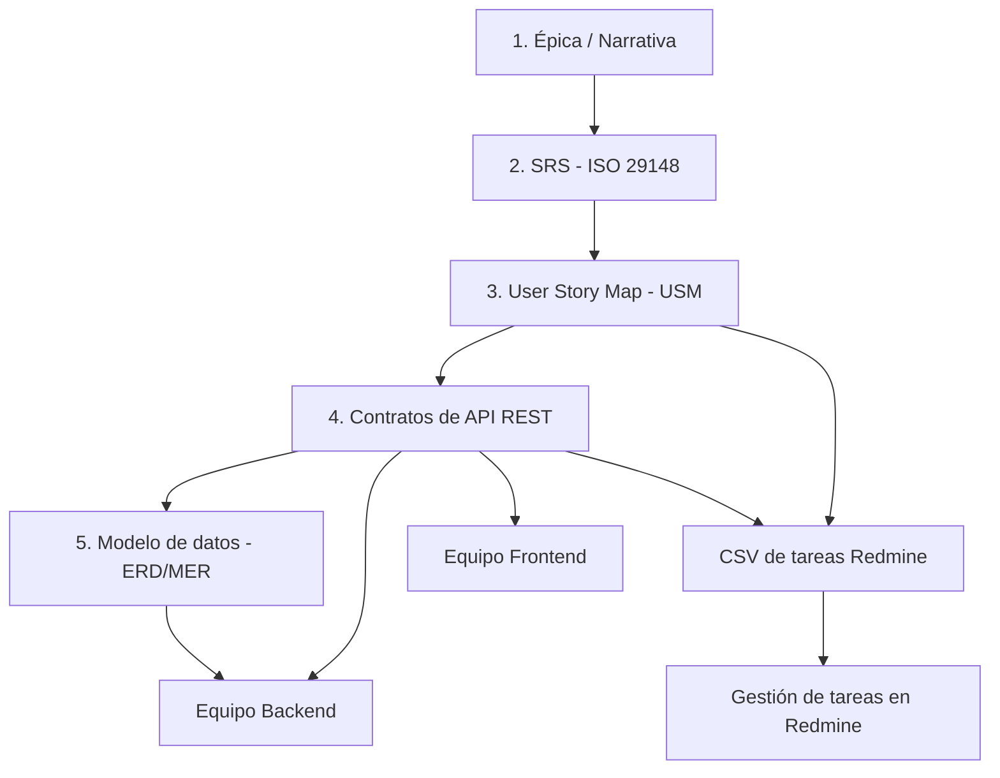

# Guía de documentación y prompts de IA

Esta plantilla utiliza **GitHub Copilot en VS Code** para transformar narrativas
en requerimientos formales, mapas de historias, contratos API, modelos de datos y
tareas para Redmine.

## Requisitos previos

1. Visual Studio Code con GitHub Copilot y su chat habilitados.
2. Una copia local del repositorio.
3. Documentos de negocio y contexto del proyecto que se desea documentar.

## Flujo de trabajo

El recorrido de diseño es **Narrativa → SRS → USM → Contratos API → ERD/MER**.
El CSV de Redmine es una salida de planificación a partir del USM y los contratos.



## Estructura

```text
.github/
├── copilot-instructions.md
└── prompts/
    ├── generar-srs-iso29148.prompt.md
    ├── generar-usm.prompt.md
    ├── generar-contrato-api.prompt.md
    ├── generar-erd-mer.prompt.md
    └── 04-generar-csv-redmine.prompt.md
```

Las carpetas de salida se crean al generar los documentos:

| Carpeta | Contenido |
| --- | --- |
| `narrativa/` | Visión de negocio y épicas |
| `SRS/` | Especificaciones de requerimientos |
| `USM/` | Mapas de historias de usuario |
| `historias/` | Historias de usuario |
| `contrato_api/` | Contratos de API REST |
| `modeloDatos/` | Modelos ERD/MER, diccionarios y esquemas |
| `redmine/` | CSV para importación de tareas |

En proyectos existentes se conservan sus rutas e identificadores; por ejemplo,
`docs/erd/` en lugar de `modeloDatos/`. No se deben crear documentos duplicados.

## Ejecución en Copilot Chat

Los archivos de `.github/prompts/` son **prompts reutilizables** (llamados
informalmente skills en esta guía), no Agent Skills con estructura `SKILL.md`.
Puedes seleccionarlos desde el menú `/` de Copilot Chat o pedir explícitamente
que se aplique el archivo indicado.

### 1. Generar SRS (ISO 29148)

Aplica [generar-srs-iso29148.prompt.md](.github/prompts/generar-srs-iso29148.prompt.md)
a la narrativa para obtener requisitos atómicos y verificables.

```text
Aplica .github/prompts/generar-srs-iso29148.prompt.md a narrativa/mi_modulo.md
y guarda la especificación en SRS/SRS_mi_modulo.md.
```

### 2. Generar el User Story Map

Aplica [generar-usm.prompt.md](.github/prompts/generar-usm.prompt.md)
para organizar historias, releases y el recorrido MVP.

```text
Aplica .github/prompts/generar-usm.prompt.md a SRS/SRS_mi_modulo.md
y guarda el mapa en USM/USM_mi_modulo.md.
```

### 3. Generar contratos API

Aplica [generar-contrato-api.prompt.md](.github/prompts/generar-contrato-api.prompt.md)
a partir del USM y la SRS.

```text
Aplica .github/prompts/generar-contrato-api.prompt.md a USM/USM_mi_modulo.md
y SRS/SRS_mi_modulo.md. Guarda el contrato en contrato_api/API_mi_modulo.md.
```

### 4. Generar el modelo ERD/MER

Aplica [generar-erd-mer.prompt.md](.github/prompts/generar-erd-mer.prompt.md)
después de los contratos API. El resultado incluye un diagrama Mermaid
`erDiagram`, diccionario de datos, relaciones, restricciones y trazabilidad.

```text
Aplica .github/prompts/generar-erd-mer.prompt.md a narrativa/mi_modulo.md,
SRS/SRS_mi_modulo.md, USM/USM_mi_modulo.md y contrato_api/API_mi_modulo.md.
Contrasta los esquemas y migraciones existentes y guarda el resultado en
modeloDatos/ERD_mi_modulo.md. Separa hechos, propuestas y pendientes.
```

El prompt es independiente del dominio y del motor. Si el motor no está
confirmado, genera el modelo lógico y deja el físico pendiente.
PostgreSQL/PostGIS se utiliza solo cuando el proyecto lo requiera; las versiones,
SRID y reglas espaciales no se asumen.

### Planificación: generar CSV para Redmine

Aplica [04-generar-csv-redmine.prompt.md](.github/prompts/04-generar-csv-redmine.prompt.md)
al USM y los contratos. Esta salida no es un prerrequisito para el ERD/MER.

```text
Aplica .github/prompts/04-generar-csv-redmine.prompt.md a USM/USM_mi_modulo.md
y contrato_api/API_mi_modulo.md. Guarda el resultado en
redmine/tareas_redmine_mi_modulo.csv.
```

## Reglas de calidad y colaboración

- **ISO 29148:** cada requisito debe seguir la estructura
  `[Sujeto] + deberá/deberán + [Acción/Condición] + [Resultado] + [Restricción]`.
- **Trazabilidad:** conserva los IDs entre narrativa, SRS, USM, API y modelo de datos.
- **Fuentes:** distingue hechos documentados, propuestas y datos pendientes.
  No inventes reglas, prioridades, métricas ni restricciones ausentes.
- **Frontend:** utiliza los contratos para implementar clientes y datos simulados
  sin depender del servidor.
- **Backend:** implementa los contratos y las reglas de negocio. Los DTOs no
  equivalen automáticamente a tablas; el modelo de persistencia debe justificar
  sus entidades, relaciones y cambios frente al esquema existente.
